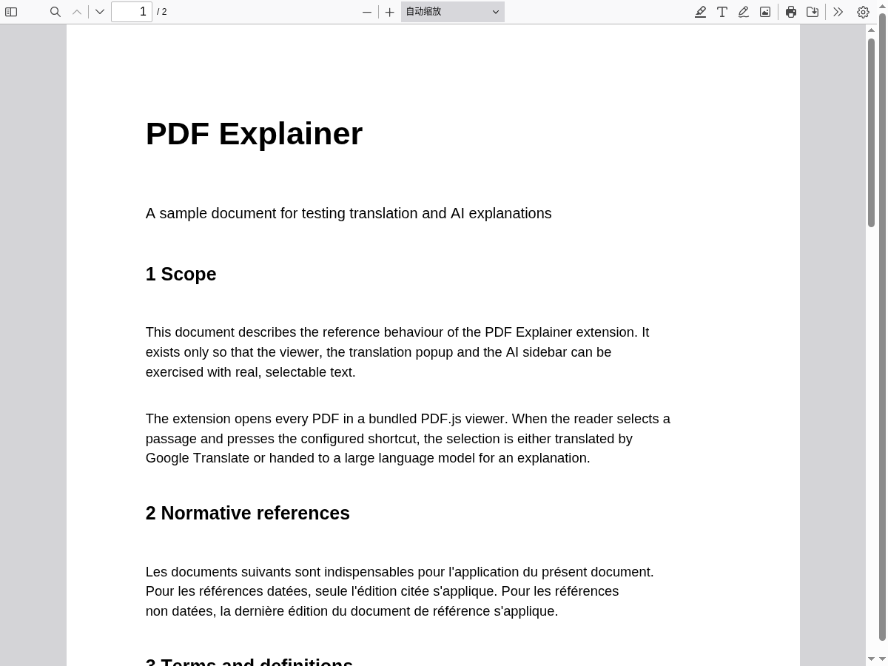
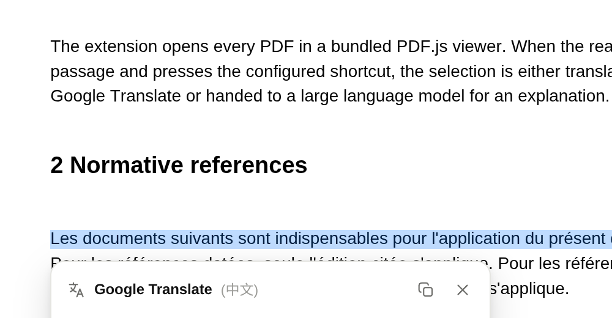
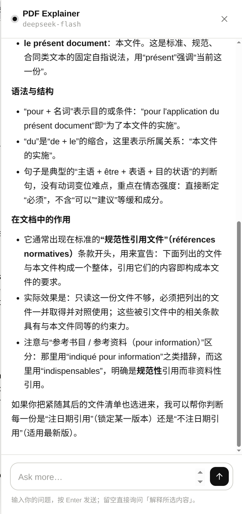
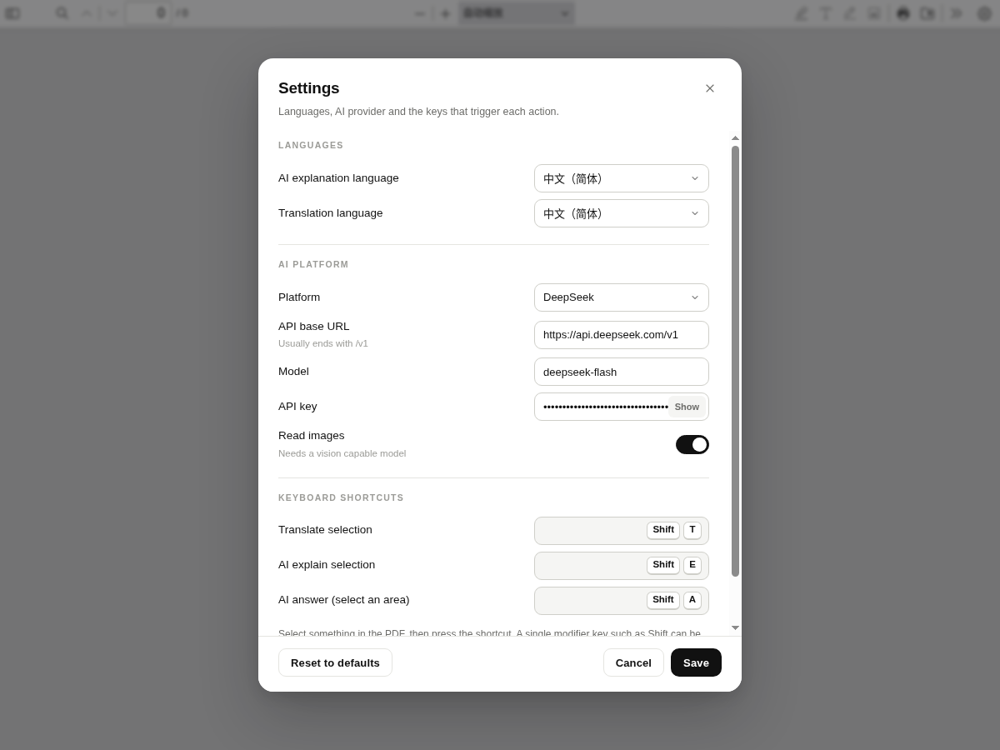

# PDF Explainer

**Read PDFs you don't fully understand.** PDF Explainer replaces the browser's built-in PDF viewer
with a [PDF.js](https://github.com/mozilla/pdf.js) one that can translate a passage, explain it with
an LLM, or answer questions about any region of the page — text or figures.

[](LICENSE)
[](#install)
[](#development)

<p align="center">
  
</p>

Three actions, three shortcuts:

| | Action | Shortcut | What you get |
| --- | --- | --- | --- |
| 1 | **Translate** | `Shift` + `T` | A Google Translate card under the selection |
| 2 | **AI Explain** | `Shift` + `E` | A sidebar that explains the passage in your language |
| 3 | **AI Answer** | `Shift` + `A` | The page dims, you drag a rectangle, press ✓, then ask |

<p align="center">
  
  
</p>

<table>
  <tr>
    <td></td>
  </tr>
</table>

---

## Features

- **Translate anything.** Select text, press a shortcut; the card shows the translation and the
  detected source language, and has a copy button.
- **Explain in your language.** The sidebar streams the answer, keeps a conversation, and lets you
  ask follow-up questions about the same passage.
- **Ask about pictures.** `Shift` + `A` dims the page; drag a rectangle around a chart, a formula or
  a paragraph, press ✓, and the cropped pixels (plus whatever text was inside) are sent to the model.
- **Your provider, your key.** Any OpenAI-compatible endpoint (DeepSeek, OpenAI, OpenRouter,
  Ollama, vLLM, LM Studio…), with an editable base URL and model name.
- **Everything is re-bindable.** Click a shortcut chip in Settings and press the combination you want
  — including a single modifier key.
- **Monochrome by design.** Black and white in light and dark themes, with the familiar PDF.js
  toolbar plus one extra settings button.
- **Local first.** Rendering, selection, cropping and the text layer never leave the machine.

---

## Install

### Chromium, Edge, Brave, Vivaldi

```bash
git clone https://github.com/<you>/pdf-explainer.git
cd pdf-explainer
python3 tools/build.py --only chromium
```

1. Open `chrome://extensions`.
2. Turn on **Developer mode**.
3. **Load unpacked** → pick `dist/chromium`.

You can also drag `dist/pdf-explainer-chromium.zip` onto the `chrome://extensions` page — Chrome
unpacks it for you. That same zip is what a store upload expects.

### Firefox

```bash
python3 tools/build.py --only firefox     # optional: the source tree works too
```

- **Quick loop:** `about:debugging#/runtime/this-firefox` → **Load Temporary Add-on…** → pick
  `manifest.json` in the repository root (the root manifest is the Firefox one).
- **Packaged:** load `dist/pdf-explainer-firefox.zip`, or sign it with
  `web-ext sign --api-key … --api-secret …` and install the resulting `.xpi`.
- **Unsigned permanent install** on Developer Edition / Nightly: set
  `xpinstall.signatures.required` to `false` in `about:config`, then install the `.xpi`.

Then open any PDF served over HTTP(S) — it opens in PDF Explainer instead of the native viewer.

> Opening a PDF locally? Enable **Allow access to file URLs** on the extension's details page, then
> use the toolbar popup to point at the file.

---

## Usage

### Settings

Click the gear at the right end of the PDF.js toolbar. You can set:

| Setting | What it does |
| --- | --- |
| AI explanation language | The language the assistant answers in |
| Translation language | Google Translate target language |
| Platform / API base URL / model / API key | Which LLM to talk to |
| Read images | Send the cropped region as an image (needs a vision-capable model) |
| Keyboard shortcuts | Record your own combination for the three actions |

The dialog dims the page behind it, so you never lose your place.

If a model rejects images, PDF Explainer automatically retries with the text it found inside the
selection and tells you why — so "Read images" can stay on.

### Toolbar popup

The extension button opens a small popup: open a PDF by URL, jump to Settings, or load the bundled
sample document.

### Escape hatch

Append `#pdf-explainer=off` to a PDF URL to keep the browser's native viewer for that request.

---

## Configuration

PDF Explainer ships **without any credentials**. The first time you press an AI shortcut it opens
Settings and asks for a key.

| Field | Default |
| --- | --- |
| Platform | DeepSeek |
| API base URL | `https://api.deepseek.com/v1` |
| Model | `deepseek-flash` |
| API key | *(empty)* |

Any OpenAI-compatible API works: point **API base URL** at the server root (it may end in `/v1`) and
`/chat/completions` is appended automatically. If your account exposes different model names, edit
the **Model** field — the value is passed through verbatim.

Translation uses the public Google Translate endpoint (`translate.googleapis.com`) and needs no key.

### Privacy and keys

- PDF rendering, text selection and region cropping happen entirely locally.
- The text you submit goes to `translate.googleapis.com` (translation) or to **your** configured AI
  endpoint (explain / answer), together with your API key. Nothing else leaves the browser.
- The key is stored in the browser's extension storage (`storage.local`) in plain text and is only
  ever sent to the endpoint you configured. Use a scoped or disposable key if that matters to you.
- Nothing is logged by the extension; no analytics, no telemetry.

---

## How it works

```
background/background.js            Firefox  – blocking webRequest redirect
background/background.chromium.js   Chromium – observe the response, navigate the tab
        │
        ▼
pdfjs/web/viewer.html               stock PDF.js viewer (4.10.38) + two extra tags
        │
        ▼
ui/pdf-explainer.js                 boot, load the PDF, route the shortcuts
   ├── settings-panel.js   modal: languages, provider, shortcut recorder
   ├── shortcuts.js        shortcut model, matching, global hotkey manager
   ├── translate.js        Google Translate client + popup card
   ├── sidebar.js          chat panel (streaming answers, markdown)
   ├── ai.js               OpenAI-compatible client (SSE streaming, vision fallback)
   ├── capture.js          region capture: crop from PDF.js canvases + text layer
   ├── storage.js          settings persistence (storage.local / localStorage)
   ├── compat.js           browser.* vs chrome.* namespace
   ├── languages.js        language catalogue
   ├── dom.js              tiny DOM helpers, icons, safe markdown renderer
   └── ui.css              the whole monochrome design system
```

### Taking over the PDF

Both background scripts watch top-level responses for `Content-Type: application/pdf` (or an `.pdf`
URL served as `application/octet-stream`) and take the navigation over. Responses marked
`Content-Disposition: attachment` are left alone, since those are explicit downloads. The target is
always `pdfjs/web/viewer.html?file=&url=<encoded>` — the empty `file=` parameter stops the stock
viewer from loading its bundled demo document, and the UI script then opens the real URL itself
(direct URL first, `fetch()` fallback for servers that need cookie-based auth).

The browsers force two different mechanisms:

- **Firefox** still allows blocking `webRequest`, so `onHeadersReceived` returns a `redirectUrl`.
- **Chromium** (MV3) removed blocking `webRequest` for regular extensions, so the service worker
  observes the headers and calls `tabs.update()` to navigate that tab to the viewer.

### Region capture

Every PDF page is already rendered into a `<canvas>`. Dragging a rectangle copies the overlapping
canvas pixels into an offscreen canvas (at the page's raster resolution, capped at 1600 px wide) and
collects the text-layer spans whose centre lies inside the rectangle. The preview inside the marquee
is produced by the same routine, so what you see is exactly what the model receives.

---

## Project layout

```
manifest.json               Firefox (MV2) manifest
manifest.chromium.json      Chromium (MV3) manifest
background/                 the two interceptors
pdfjs/                      vendored PDF.js 4.10.38 (Apache-2.0)
ui/                         viewer UI, settings, translate, AI, capture
popup/                      toolbar popup
icons/                      SVG (Firefox) and PNG (Chromium) icons
sample/                     sample.pdf used for manual testing
tools/                      build.py, make_sample_pdf.py
docs/                       README screenshots
```

---

## Development

No bundler, no transpiler — the sources are ES modules loaded directly. `tools/build.py` only copies
files and zips them:

```bash
python3 tools/build.py                     # both targets
python3 tools/build.py --only chromium     # one target
```

```
dist/firefox/                MV2 build          → dist/pdf-explainer-firefox.zip
dist/chromium/               MV3 build          → dist/pdf-explainer-chromium.zip
```

Both packages share everything except the manifest, the background script and the icon format
(Chrome cannot use SVG icons; `icons/icon-*.png` are rasterised from `icons/icon.svg`).

### Working on the UI without an extension

```bash
python3 -m http.server 8123
# http://127.0.0.1:8123/pdfjs/web/viewer.html?file=&url=<pdf-url>
```

In that mode neither `browser.*` nor `chrome.*` exists, so settings fall back to `localStorage` while
translation and AI calls keep working (they are plain `fetch()` calls). `?settings=1` opens the
settings dialog directly.

### Regenerating things

- `python3 tools/make_sample_pdf.py` rebuilds `sample/sample.pdf`.
- Before publishing to AMO, replace the placeholder Gecko ID
  (`pdf-explainer@example.org` in `manifest.json`) with one of your own.
- To update PDF.js: unzip a new `pdfjs-<version>-dist.zip` from the
  [releases](https://github.com/mozilla/pdf.js/releases), drop the `*.map` files, and re-apply the
  two `<link>`/`<script>` tags in `pdfjs/web/viewer.html`.

### Known limitations

- PDFs produced by `POST` requests, `blob:` URLs and `file://` files are not intercepted.
- PDFs inside an `<iframe>`/`<embed>` are taken over in Firefox only; Chromium's service worker
  navigates the whole tab, which would be wrong for an embedded viewer.
- On Chromium the hand-off is a second navigation, so the tab can flash briefly. If the very first
  page after a browser restart is a PDF, the service worker may not have registered yet and the
  native viewer wins that one time.
- The bundled PDF.js build is 4.10.38 — the viewer's own features (save, print, find, text layer)
  work as usual.

---

## License

Licensed under the [Apache License, Version 2.0](LICENSE). Attribution details are in
[NOTICE](NOTICE).

The bundled [PDF.js](https://github.com/mozilla/pdf.js) is distributed under the same license — see
`pdfjs/LICENSE`.

PDF Explainer is an independent project and is not affiliated with Mozilla.
